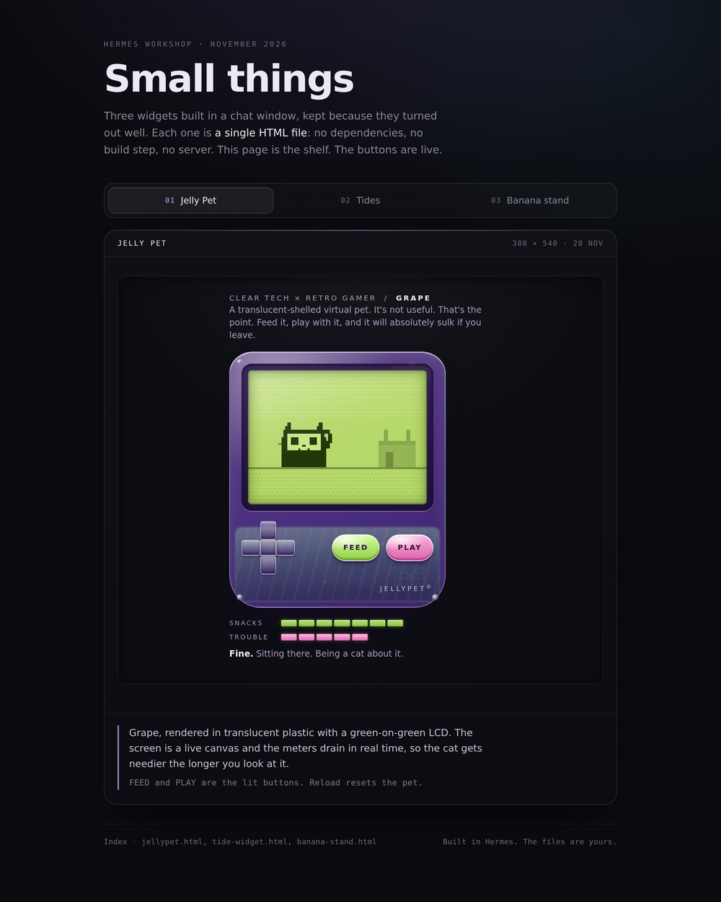

# Small things

Three small HTML widgets, built in Hermes in November 2026, plus one page that puts
them on a shelf.

## Start here: index.html

Open `index.html` in a browser. It is the combined page: a tab bar with all three
widgets, each one running live inside its own frame. No build step, no server, no
dependencies. Double-click it, or host it and share the link.

If you put this folder on GitHub Pages, `index.html` is what visitors land on.

Caveat worth knowing: the file is about 39 KB because the three widgets are embedded
inside it as copies. If you edit `jellypet.html` on its own, the copy in `index.html`
does not update. Regenerate the page from the originals if you change one.

## The three widgets

Each is still a separate, self-contained file. Open any of them directly and it works
on its own.

**jellypet.html** is a pixel-art virtual pet on a translucent handheld. Three meters
and two working buttons, feed and play. The screen is a live canvas, the meters drain
in real time, and state resets on reload. The most interactive of the three.

**tide-widget.html** is a 24-hour tide chart for Charleston Harbor, NOAA station
8665530, feet above MLLW. Real observed data for Saturday 21 November 2026, not
invented numbers. The data is baked in as a snapshot, so it does not fetch live tides.

**banana-stand.html** is the joke one: the Bluth's Original Frozen Banana stand. One
button, eleven quotes from two shows, a counter keeping score of bananas dispensed.

## Buttons need a real browser

The buttons run JavaScript. Some previewers show HTML as text or as a frozen image
with scripts off: Telegram's viewer, phone Files apps, GitHub's raw file view. Nothing
will happen when you click in those. Open the file in an actual browser, or view it
through GitHub Pages.

## Hosting on GitHub Pages

1. Put this folder's contents in a repo.
2. Settings, then Pages, then deploy from the `main` branch, root folder.
3. The page lands at `https://<your-username>.github.io/<repo>/`.

A first build can 404 for a minute. Wait before debugging.
